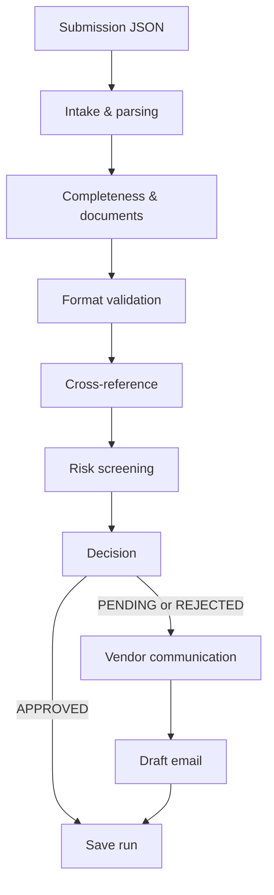

# Vendor onboarding: from submission to approval

A Streamlit case-study app that checks one vendor submission, explains each
deterministic rule, assigns an `APPROVED`, `PENDING`, or `REJECTED` status, and
drafts a follow-up email for submissions that need attention. Runs are stored
in SQLite; a demo resubmission links its new run to the original.

## Process map



The stages run in order: **Intake & parsing**, **Completeness & documents**,
**Format validation**, **Cross-reference**, **Risk screening**, **Decision**,
and **Vendor communication**. Communication is only run when the result is not
approved.

## Run locally

Python 3.11 or newer is required. Create and activate a virtual environment,
then install the pinned dependencies:

```powershell
python -m venv .venv
.\.venv\Scripts\Activate.ps1
pip install -r requirements.txt
Copy-Item .env.example .env
streamlit run app.py
```

Edit `.env` to select an LLM provider and set its key. Supported providers are
`gemini`, `openai`, and `anthropic`. If no key is configured, name matching and
email drafting use local fallbacks. Before launching, set a non-empty
`APP_PASSWORD` in `.env`; a password is required before the app shows any
vendor records. Generate a `DATA_ENCRYPTION_KEY` as described below, or the
local app creates a private ignored key file automatically. To run tests:

```powershell
python -m pytest -q
```

To print CLI progress for a sample:

```powershell
python pipeline.py data/samples/happy_path.json
```

To make one real Gemini connectivity check using `LLM_API_KEY` from the local
`.env` file and print either the response or the full sanitized exception:

```powershell
python test_llm.py
```

This diagnostic makes a provider request and should only be run with a key you
control. It never prints the key.

## Demo features and edge cases

The **Run** tab accepts a sample, form submission, or uploaded JSON. A pending
run offers **Simulate vendor resubmission**: the demo fills missing fields,
adds required documents, and applies the relevant example correction, then
reruns checks and links the new run to its parent.

Included sample scenarios cover four important edge cases:

1. **Wrong-country tax format:** an Indian submission with a US EIN-shaped tax
   ID is rejected and the reason identifies the US format.
2. **Duplicate bank account:** a new company using an account in the approved
   vendor master is rejected as a possible duplicate/fraud risk.
3. **Missing document:** a submission without required bank proof is pending;
   the resubmission demo adds it and can approve the corrected submission.
4. **Company/bank-holder name mismatch:** unrelated names are rejected or
   held for review depending on match confidence; legal suffix variants such
   as `Pvt Ltd` and `Private Limited` normalize to the same name.

The Dashboard includes totals, status distribution, run search and filters,
rule/email details, bulk sample runs, and history clearing. The Assumptions tab
describes country coverage, required documents, and decision behavior.

## Configuration and Streamlit Community Cloud

The app requires an `APP_PASSWORD` before exposing submission data or
dashboard controls. The app reads `APP_PASSWORD`, `LLM_API_KEY`, `LLM_PROVIDER`,
`LLM_ENABLED`, `LLM_MODEL`, and `DATA_ENCRYPTION_KEY` from the environment or `.env`.
Environment variables take precedence; if unavailable, the app reads those
settings from Streamlit secrets. For Community Cloud, add values in the app's
**Settings → Secrets** using TOML:

```toml
APP_PASSWORD = "choose-a-strong-app-password"
LLM_API_KEY = "your-provider-key"
LLM_PROVIDER = "gemini"
LLM_ENABLED = "true"
DATA_ENCRYPTION_KEY = "generated-fernet-key"
# LLM_MODEL = "provider-model-name"
```

Gemini requests use a 10-second timeout and one attempt (the API rejects
deadlines below 10 seconds). After a provider failure, the app skips LLM calls
for 120 seconds and immediately uses its local fallbacks. Set
`LLM_ENABLED = "false"` to disable provider calls entirely.

Generate an encryption key locally with:

```powershell
python -c "from cryptography.fernet import Fernet; print(Fernet.generate_key().decode())"
```

Never commit `.env`, `.app-data.key`, or real credentials. Database
submissions are encrypted at rest. Locally, a Fernet key is generated in the
ignored `.app-data.key` file if `DATA_ENCRYPTION_KEY` is not configured. For
Community Cloud, set `DATA_ENCRYPTION_KEY` in secrets so data remains
decryptable across app restarts. The SQLite database is still local and
ephemeral on Community Cloud; use durable managed storage for production.

## Limitations and next steps

- Tax IDs and bank details are checked for format and compared with the
  bundled sample master only. They are **not verified against government,
  banking, or other authoritative registries**. The next production step is
  secure, audited integration with appropriate verification services, plus
  manual review when those services are unavailable or inconclusive.
- LLM name matching is advisory and uses a fallback when a call is unavailable.
  A positive LLM result for substantially different names is held for review;
  production decisions should retain human review and audit trails.
- The shared `APP_PASSWORD` is a demo access gate, not a user/role identity
  system. Use a proper authentication provider for a multi-user production
  procurement application.
- Vendor-master data and sample submissions are fictional examples.
- SQLite persistence is intended for a local case study; a hosted deployment
  should use durable managed storage with access controls and backups.
- Email is drafted only; delivery, identity verification, and document storage
  are not implemented.
